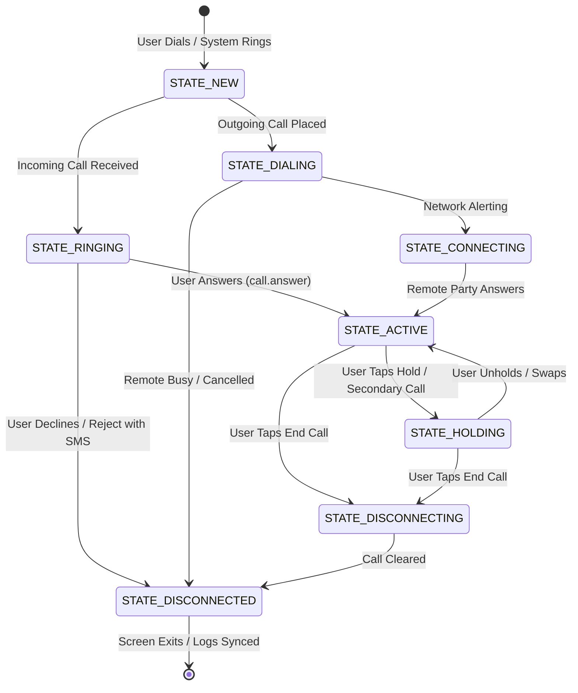

# TowerChat Cellular Voice & Native Dialer Specification

**Version:** 1.0  
**Status:** Approved Specification  
**Branch:** `feature/calls`  
**Target Platform:** Android 8.0 (API 26) through Android 15 (API 35)  
**Architecture:** Kotlin, Jetpack Compose, Hilt, TelecomManager, InCallService  

---

## 1. Architectural Principles & Ground Rules

TowerChat extends its foundational principle — *"TowerChat is a UI layer; the carrier network is the backend"* — to cellular voice communication.

1. **Zero-Storage Privacy Guarantee**:
   * No backend, no analytics, no external network calls.
   * Nothing about calls (audio, metadata, durations, timestamps, contacts) is written to app storage, files, SharedPreferences, Room/SQLite databases, or application log files.
   * Call history is read on demand directly from the Android system call log (`CallLog.Calls`) through `ContentResolver`.
2. **Emergency Call Zero-Bypass**:
   * Dialing `112` or device-localized emergency numbers bypasses all custom dialer routing, timers, confirmation dialogs, or SIM picker delays, passing immediately and unconditionally to `TelecomManager.placeCall()` or system emergency dialer.
3. **Graceful Fallback Matrix**:
   * When granted the default dialer role (`RoleManager.ROLE_DIALER`), TowerChat hosts the complete native incoming and in-call UI via `InCallService`.
   * If the default dialer role is declined, revoked, or ungranted, TowerChat gracefully falls back to placing calls via `TelecomManager.placeCall()` with `CALL_PHONE`, or `Intent.ACTION_DIAL`, ensuring zero app crashes.
4. **Android SDK Range & Compatibility**:
   * `minSdk = 26` (Android 8.0 Oreo), `targetSdk = 35` (Android 15).
   * Any API newer than 26 strictly uses runtime SDK checks (`Build.VERSION.SDK_INT`) with backward-compatible fallbacks.
5. **Strict Isolation**:
   * Crypto, ECDH handshake, and SMS chat engines are completely isolated from calling code. Reject-with-SMS uses standard `SmsManager` plain text dispatch and never routes through E2EE encrypted channels.

---

## 2. Scope Matrix

### In-Scope (To Build)
* **Calls Tab**: Top-level navigation adjacent to Chats, featuring:
  * **Keypad with T9 Smart Dial**: Real-time matching against contact names (T9 letter-to-digit) and phone numbers.
  * **Recents**: Paged call log from `CallLog.Calls` with grouped entries by number, timestamps, call types (incoming, outgoing, missed, rejected, blocked), and duration.
  * **Favorites**: Quick access to starred contacts from `ContactsContract.Contacts.STARRED`.
  * **Contacts**: Alphabetical contact directory with fast search.
  * **Search**: Universal search querying contacts and call logs.
  * **Voicemail Button**: Long-press '1' or dedicated voicemail button dialing carrier voicemail (`TelephonyManager.getVoiceMailNumber()`).
* **Call Details Screen**:
  * Displays contact name, number, normalized format, avatar, and call timestamp history.
  * Action buttons: "Call", "Message" (opens existing TowerChat chat thread), and "Block Number".
* **SIM Choice Selector**:
  * Bottom sheet or dialog for dual-SIM devices selecting `PhoneAccountHandle`.
  * Displays carrier name and slot index for each active SIM.
* **Incoming Call Screen**:
  * Full-screen intent notification on lock screen and heads-up banner when unlocked.
  * Contact photo, name/number, location indicator.
  * Actions: Answer (swipe/tap), Decline, Reject with Quick SMS.
* **In-Call Active Call Screen**:
  * Contact name/number, call state indicator, and live call timer (`MM:SS`).
  * Call Controls: Mute microphone, Speakerphone toggle, Audio route selector (Earpiece, Speaker, Bluetooth, Wired), Hold/Unhold, DTMF Keypad sheet, Add Call, Merge Calls (Conference), Swap Calls, End Call.
* **Proximity Wake Lock**:
  * Screen automatically turns off when the phone is held to the ear during earpiece audio routing and turns back on when moved away.
* **Call Waiting UI**:
  * Overlay/banner for secondary incoming call while on an active call.
  * Actions: Answer & Hold Current, Answer & End Current, Reject.
* **Missed Call Notification**:
  * System notification for unanswered calls with one-tap "Call back" and "Message" actions.
* **Number Blocking**:
  * Block and unblock phone numbers using Android's system `BlockedNumberContract` (when acting as default dialer).
  * Dedicated Blocked Numbers management screen.
* **Dark / Light Theme & Accessibility**:
  * Fully reactive to system dark mode with high-contrast Google Phone-style layout tokens.
  * 48dp+ touch targets and screen-reader accessible content descriptions.

### Out of Scope (Do Not Build)
* Spam detection / cloud lookup algorithms.
* Caller ID network lookup.
* Google Call Screen / AI screening.
* Hold for Me / automated waiting assistants.
* Call recording.
* Visual voicemail (audio file download / transcription).
* Custom speed dial widgets.
* Video calls (VoLTE video / carrier-restricted).

---

## 3. Screen List & Detailed UI Specifications

### 3.1 Calls Tab (`CallsScreen`)
Adjacent to the Conversations list on the primary screen. Contains a sub-navigation bar: **Favorites**, **Recents**, **Contacts**, and a persistent floating dialpad toggle.
* **Keypad & Smart Dial (`KeypadSection`)**:
  * 12-key telephone grid (`1` through `9`, `*`, `0 +`, `#`).
  * T9 sub-labels: `2` (ABC), `3` (DEF), `4` (GHI), `5` (JKL), `6` (MNO), `7` (PQRS), `8` (TUV), `9` (WXYZ).
  * Long-press on `1`: Initiates call to carrier voicemail number.
  * Long-press on `0`: Inserts `+` for international dialing.
  * Smart Dial Search Bar: As digits are tapped, a reactive list displays matching contacts filtered by T9 name transliteration or phone number substring matches.
  * Backspace button: Short press deletes last digit; long-press clears input.
  * Call Action Button: Large floating pill button initiating call. If dual SIM, indicates active SIM or triggers SIM selector.
* **Recents (`RecentsSection`)**:
  * Loads records from `CallLog.Calls` using `ContentResolver` on an IO coroutine dispatcher.
  * Paged in batches of 50 items.
  * Groups consecutive calls to/from the same number on the same calendar day into a single expandable row with call count badge (e.g. `(3)`).
  * Visual indicators:
    * ↙ Green: Incoming answered call.
    * ↗ Blue: Outgoing call.
    * ↙ Red: Missed call.
    * ⊘ Grey: Rejected / Blocked call.
  * Tap row: Opens `CallDetailScreen` or immediately dials based on user setting.
* **Favorites (`FavoritesSection`)**:
  * Grid/list of contacts marked with `STARRED = 1` in Android Contacts.
  * One-tap calling to primary phone number.
* **Contacts (`ContactsSection`)**:
  * Alphabetical list with sticky header letters (`A`, `B`, `C`...).
  * Search bar at top filtering contacts in real time.
* **Edge Cases on Calls Tab**:
  * *Permission Denied (`READ_CALL_LOG` / `READ_CONTACTS`)*: Displays an inline contextual rationale banner explaining why permission is required with a "Grant Permission" button.
  * *Permanently Denied*: Shows "Open App Settings" button directing to `Settings.ACTION_APPLICATION_DETAILS_SETTINGS`.
  * *No SIM / Airplane Mode*: Disables keypad call button and displays a non-blocking warning banner: *"No cellular service available"*.
  * *Dual SIM*: Keypad shows SIM 1 / SIM 2 toggle pill.

---

### 3.2 Call Details Screen (`CallDetailScreen`)
Navigated to from a Recents item or Contact card.
* **Header**: Large contact avatar (`GoogleAvatar`), display name (or formatted number if unsaved), and primary number with phone label (e.g., *Mobile*, *Work*).
* **Action Row**:
  * **Call**: Initiates cellular call.
  * **Message**: Opens TowerChat's encrypted chat thread (`activeRecipient` set to this number).
  * **Block / Unblock**: Toggles number in `BlockedNumberContract`.
* **Call Log History Section**:
  * Chronological list of historical calls with this number: date, time, duration, call type icon, and SIM slot used.

---

### 3.3 SIM Choice Selector (`SimChoiceDialog`)
Presented when placing an outgoing call on a device with two active SIM subscriptions and no default voice SIM assigned by the system.
* Displays both SIM slots retrieved from `TelecomManager.getCallCapablePhoneAccounts()` / `SubscriptionManager.getActiveSubscriptionInfoList()`.
* Shows carrier brand (e.g., *Jio 4G*, *Airtel*), mobile number (if available), and slot index.
* Tapping a SIM immediately dispatches the call with `TelecomManager.EXTRA_PHONE_ACCOUNT_HANDLE`.

---

### 3.4 Incoming Call Screen (`IncomingCallActivity` / `IncomingCallView`)
Launched by `TowerchatInCallService` via full-screen intent when an incoming call arrives in state `Call.STATE_RINGING`.
* **Lock Screen Presentation**: Uses `setShowWhenLocked(true)` and `setTurnScreenOn(true)` on Android 8.0+ (`Activity.setShowWhenLocked` / `Activity.setTurnScreenOn`).
* **Visual Elements**:
  * Dark ambient backdrop with subtle pulse animation.
  * Caller identity: Display name resolved from contacts or formatted phone number.
  * Location / carrier tag: e.g., *"Incoming cellular call"*.
* **Interactive Elements**:
  * **Decline**: Red round button (or swipe down) calls `call.reject(false, null)`.
  * **Answer**: Green round button (or swipe up) calls `call.answer(VideoProfile.STATE_AUDIO_ONLY)`.
  * **Quick Decline with SMS**: Message icon triggers a modal sheet with quick templates:
    * *"Can't talk right now. What's up?"*
    * *"I'll call you right back."*
    * *"On my way."*
    * Custom reply text field.
    * Tapping a template dispatches plain SMS via `SmsManager` and rejects the call.

---

### 3.5 Active In-Call Screen (`InCallActivity` / `InCallView`)
The primary interface while a call is in `STATE_DIALING`, `STATE_CONNECTING`, `STATE_ACTIVE`, or `STATE_HOLDING`.
* **Top Header**:
  * Caller name or number.
  * Call state label: *"Dialing..."*, *"Connecting..."*, *"02:45"*, or *"On Hold"*.
* **Center Area**:
  * Large contact avatar or audio wave animation.
* **Control Grid (3x2 Buttons)**:
  1. **Mute**: Toggles microphone mute (`InCallService.setMuted(boolean)`).
  2. **Keypad**: Opens in-call DTMF dialpad overlay to enter extensions, IVR options, or pin codes via `call.playDtmfTone(char)` and `call.stopDtmfTone()`.
  3. **Speaker / Audio Route**:
     * If Bluetooth or wired headset connected: Opens bottom sheet selecting `EARPIECE`, `SPEAKER`, `BLUETOOTH`, or `WIRED_HEADSET`.
     * If no headset: Directly toggles speakerphone on/off.
  4. **Add Call**: Opens contact picker / dialpad to place a secondary call.
  5. **Hold**: Toggles call hold (`call.hold()` / `call.unhold()`).
  6. **Merge / Swap**: When a second call is active or on hold, transforms dynamically into **Merge** (conference) or **Swap**.
* **Bottom Bar**:
  * Large red pill **End Call** button calling `call.disconnect()`.
* **Proximity Sensor Integration**:
  * When audio route is `EARPIECE`, acquires `PowerManager.PROXIMITY_SCREEN_OFF_WAKE_LOCK` to blank screen when near user's face, preventing unintended touch inputs. Releases wake lock when route switches to `SPEAKER` or `BLUETOOTH`.

---

### 3.6 Call Waiting Interface
* Triggered when an incoming call arrives while another call is in `STATE_ACTIVE`.
* Banner slides down from top of `InCallScreen` displaying incoming caller info.
* Actions:
  * **Answer & Hold**: Puts active call on hold and answers the new call.
  * **Answer & End**: Disconnects active call and answers the new call.
  * **Decline**: Rejects incoming call without interrupting active conversation.

---

### 3.7 Missed Call Notification
* Built with `NotificationCompat.Builder` on channel `CHANNEL_MISSED_CALLS`.
* Displays caller name/number and timestamp.
* Action buttons:
  * **Call Back**: `PendingIntent` triggering `TelecomManager.placeCall` or `ACTION_CALL`.
  * **Message**: `PendingIntent` opening TowerChat chat screen directly.

---

### 3.8 Blocked Numbers Screen (`BlockedNumbersScreen`)
* Accessible from Calls Tab overflow menu.
* Queries `BlockedNumberContract.BlockedNumbers.CONTENT_URI`.
* Lists all blocked numbers with unblock button.
* "Add Number" button to manually block a specific phone number.

---

## 4. Call State Machine & Lifecycle

The lifecycle of voice calls is governed by Android Telecom framework events delivered to `InCallService`.



### State-to-UI Mapping

| Telecom State | Internal Enum | UI Display | Available Actions |
| :--- | :--- | :--- | :--- |
| `Call.STATE_NEW` | `NEW` | Initializing... | Cancel |
| `Call.STATE_DIALING` | `DIALING` | "Dialing..." | Speaker, Mute, End Call |
| `Call.STATE_RINGING` | `RINGING` | "Incoming call" | Answer, Decline, Reject with SMS |
| `Call.STATE_CONNECTING` | `CONNECTING` | "Connecting..." | Speaker, Mute, End Call |
| `Call.STATE_ACTIVE` | `ACTIVE` | Timer (`MM:SS`) | Mute, Speaker, Route, Keypad, Hold, Add, End |
| `Call.STATE_HOLDING` | `HOLDING` | "On Hold" (`MM:SS`) | Unhold, Swap, End Call |
| `Call.STATE_DISCONNECTING` | `DISCONNECTING` | "Ending call..." | None (disabled) |
| `Call.STATE_DISCONNECTED` | `DISCONNECTED` | "Call Ended" | Window closes automatically after 1.5s |

---

## 5. Permissions & Android Platform Compliance Table

All permissions and attributes have been verified against [Android Developers Documentation](https://developer.android.com/reference/android/Manifest.permission).

| Permission / Attribute | Level | Min API | Target / Notes | Reason in TowerChat |
| :--- | :--- | :--- | :--- | :--- |
| `android.permission.CALL_PHONE` | Dangerous (Runtime) | 1 | All | Directly places outgoing voice calls without redirecting to system dialer. |
| `android.permission.READ_CALL_LOG` | Dangerous (Runtime) | 16 | All | Reads system call history to populate the Recents list. |
| `android.permission.WRITE_CALL_LOG` | Dangerous (Runtime) | 16 | All | Deletes call log entries or marks missed calls as read. |
| `android.permission.READ_PHONE_STATE` | Dangerous (Runtime) | 1 | All | Inspects SIM slots, telephony state, and carrier info. |
| `android.permission.READ_CONTACTS` | Dangerous (Runtime) | 1 | All | Displays contact names and avatars in Recents and Contacts tab. |
| `android.permission.POST_NOTIFICATIONS` | Dangerous (Runtime) | 33 | Android 13+ | Displays incoming call heads-up alerts and missed call notifications. |
| `android.permission.USE_FULL_SCREEN_INTENT` | Normal / Special | 29 | Android 14+ rules | Launches incoming call screen over lock screen. Auto-granted to default dialer on API 34+. |
| `android.permission.MANAGE_ONGOING_CALLS` | Normal | 31 | Android 12+ | Companion calling support when not running as primary InCallService. |
| `android.permission.VIBRATE` | Normal | 1 | All | Haptic feedback for incoming ringtone and keypad touches. |
| `android.permission.WAKE_LOCK` | Normal | 1 | All | Maintains CPU wake lock during active call audio and proximity blanking. |
| `android.permission.BIND_INCALL_SERVICE` | Signature / System | 23 | Required on Service | Protects `InCallService` so only the Android Telecom framework can bind to it. |

### Manifest Declarations Required for Default Dialer Role
```xml
<!-- InCallService implementation -->
<service
    android:name=".telecom.TowerchatInCallService"
    android:permission="android.permission.BIND_INCALL_SERVICE"
    android:exported="true">
    <meta-data
        android:name="android.telecom.IN_CALL_SERVICE_UI"
        android:value="true" />
    <meta-data
        android:name="android.telecom.IN_CALL_SERVICE_RINGING"
        android:value="true" />
    <intent-filter>
        <action android:name="android.telecom.InCallService" />
    </intent-filter>
</service>

<!-- Dialer Activity Intent Filters -->
<activity
    android:name=".ui.MainActivity"
    android:exported="true"
    ...>
    <intent-filter>
        <action android:name="android.intent.action.DIAL" />
        <category android:name="android.intent.category.DEFAULT" />
    </intent-filter>
    <intent-filter>
        <action android:name="android.intent.action.DIAL" />
        <category android:name="android.intent.category.DEFAULT" />
        <data android:scheme="tel" />
    </intent-filter>
    <intent-filter>
        <action android:name="android.intent.action.VIEW" />
        <action android:name="android.intent.action.CALL_BUTTON" />
        <category android:name="android.intent.category.DEFAULT" />
        <category android:name="android.intent.category.BROWSABLE" />
        <data android:scheme="tel" />
    </intent-filter>
</activity>
```

---

## 6. Audio Routing & Version Branching

Android altered audio endpoint management in API 34 (Android 14). TowerChat implements dual-branch audio route control:

### Branch A: API 26 – API 33 (`CallAudioState`)
* Listen to `InCallService.onCallAudioStateChanged(audioState: CallAudioState)`.
* Inspect available mask: `audioState.supportedRouteMask`.
* Current active route: `audioState.route` (`ROUTE_EARPIECE`, `ROUTE_SPEAKER`, `ROUTE_BLUETOOTH`, `ROUTE_WIRED_HEADSET`).
* Modify route via `inCallService.setAudioRoute(CallAudioState.ROUTE_...)`.

### Branch B: API 34+ (`CallEndpoint`)
* Listen to `InCallService.onCallEndpointChanged(endpoint: CallEndpoint)` and `onAvailableCallEndpointsChanged(endpoints: List<CallEndpoint>)`.
* Switch route via `inCallService.requestCallEndpointChange(targetEndpoint, executor, outcomeReceiver)`.
* Fallback to `CallAudioState` if endpoint negotiation is unsupported by device OEM.

---

## 7. Emergency Calling Zero-Bypass Architecture

1. **Detection**:
   * Any dialed number matching `112`, `911`, `100`, `101`, `102`, `108` or verified by `PhoneNumberUtils.isEmergencyNumber(number)` is classified as an **Emergency Call**.
2. **Direct Dispatch**:
   * Does NOT show custom SIM picker dialog.
   * Does NOT show confirmation or rate-limiting warnings.
   * Does NOT log or intercept.
   * Passes directly to `TelecomManager.placeCall(Uri.parse("tel:$emergencyNumber"), Bundle().apply { putBoolean(TelecomManager.EXTRA_IS_EMERGENCY_CALL, true) })` or dispatches `Intent(Intent.ACTION_CALL, Uri.parse("tel:$emergencyNumber"))`.

---

## 8. Privacy & Zero-Persistence Rules for Voice

1. **No In-App Database for Calls**:
   * No Room `@Entity` or SQLite tables for calls.
   * Recents query `CallLog.Calls` on demand with a memory-only cache that expires when the user navigates away or when the app lifecycle pauses.
2. **FLAG_SECURE Compliance**:
   * Screen recording and screenshot capture are blocked on all calling screens in release builds (`!BuildConfig.DEBUG`).
   * When user enters in-call DTMF mode (typing bank pins or meeting passwords), `FLAG_SECURE` strictly shields the window.
3. **No Audio Recording**:
   * TowerChat contains zero microphone recording pipes (`AudioRecord` / `MediaRecorder`). Microphone audio is strictly handled hardware-to-baseband by the Android Telecom stack.

---

## 9. Implementation Phasing Plan

* **Phase 1 (Current)**: Specification approval, documentation updates, and baseline validation.
* **Phase 2**: Calls Tab UI (Keypad with T9 Smart Dial, Recents with grouped paging, Contacts, Favorites, Search, SIM choice, and direct call dispatch).
* **Phase 3**: Default Dialer Role integration (`RoleManager`, `InCallService` registration, manifest filters).
* **Phase 4**: In-Call & Incoming Call UI (`InCallService` repository, audio routing, proximity sensor, call waiting, missed call notification).
* **Phase 5**: Blocked numbers management (`BlockedNumberContract`), light/dark theme polish, accessibility, and touch target validation.
* **Phase 6**: Multi-device & multi-OEM testing, documentation finalization, and release verification.
